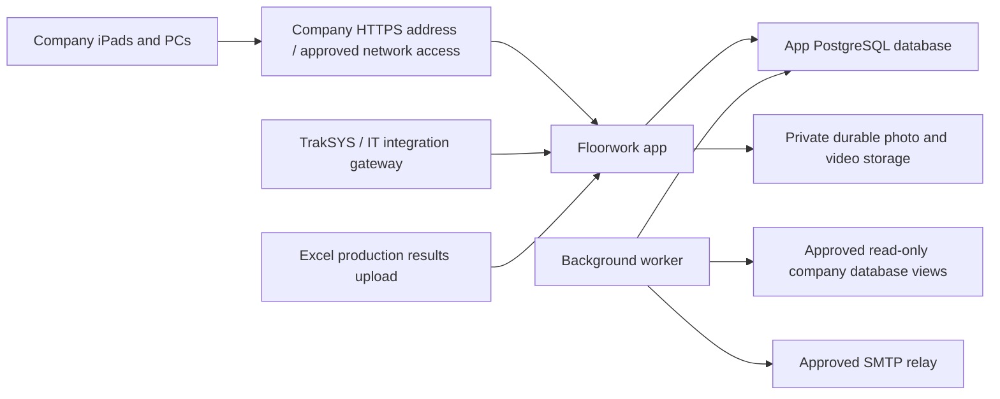

# Company ownership, hosting and systems integration

## Make it a company-controlled product

1. Have company IT/legal confirm ownership of the custom code, employee/contractor IP assignments, and permitted use of generated code. Apply a company-approved proprietary license and copyright notice to company-owned code after that review. Repository ownership alone is not a legal IP assignment.
2. Transfer the repository to a company-controlled GitHub organization (or an approved internal Git service) and make it private. Give named maintainers access, enforce MFA and protected reviews, and keep recovery/billing under company accounts. This workflow does not change the repository owner, visibility or license automatically. Previously public copies cannot be recalled by changing visibility.
3. Preserve required third-party licenses/notices. `third-party-license-inventory.json` lists declared licenses from the locked dependency graph, including development and platform-specific packages; it is an inventory, not a legal determination or complete notice bundle. Some image-processing binaries/libvips use LGPL licenses. Legal should review corresponding-source/relinking and notice requirements for the actual runtime distribution. Making the custom app proprietary does not make its third-party libraries company-owned.
4. Maintain release versions, backups, vulnerability updates, a support owner and an independently reviewed production deployment. AI-assisted tests are not a penetration-test certification.

GitHub instructions: [transfer ownership](https://docs.github.com/en/repositories/creating-and-managing-repositories/transferring-a-repository), [change visibility](https://docs.github.com/en/repositories/managing-your-repositorys-settings-and-features/managing-repository-settings/setting-repository-visibility). Third-party guidance: [Open Source Initiative FAQ](https://opensource.org/faq).

## Central company hosting

Use one IT-managed always-on server or approved cloud deployment, rather than separate databases on employee PCs. The current app needs Node.js 24, PostgreSQL 17, durable private media storage, HTTPS, and its background worker. Linux services/containers or a supervised Windows service can run the server. The Windows launcher is for local startup; this update is tested on Linux, not on native Windows.



- Set `APP_ORIGIN` to an existing company subdomain with a trusted HTTPS certificate, for example `https://floorwork.example.com`. IT configures DNS, reverse proxy/firewall rules, and private database connectivity. A new public domain is optional.
- `DATABASE_URL` is the app's PostgreSQL database, not the company's Microsoft SQL Server. Use a private database/network and least-privileged runtime credentials; keep migration credentials separate where needed. `DATABASE_SETUP_URL` may use different credentials but must name the same host, port and database as `DATABASE_URL`; setup refuses mismatched targets.
- Keep `.env`, connection secrets, uploaded media and database backups out of Git. Use the company's secret manager/environment configuration. Default media lives in `uploads`; private Azure Blob is also supported. Back up database and media together and test restoration.
- Supervise the app and the background worker. `npm start` starts both unless `FLOORWORK_WORKER_MODE=external`; external mode requires a separately supervised worker. SQL feeds, overdue checks and queued mail continue without a browser only while that worker runs.
- Configure an approved TLS SMTP relay using the private `SMTP_*` settings. No real company SMTP, SQL or TrakSYS connection was made during development. Do not put passwords into chat or screenshots.
- The app currently uses individual local accounts. Native Microsoft Entra SSO/MFA is not implemented. IT can restrict network access through its approved VPN/access gateway; full company SSO still requires a separate implementation and validation. Do not treat a proxy login as a replacement for app authorization.
- Distribute the HTTPS app to iPads as managed web clips/PWA icons through Intune or other MDM. Employees do not need Node, Docker or database software. A native iOS/Windows installer is not included in this change.

## Connect TrakSYS first

Use [factory-integrations.md](factory-integrations.md) for the existing real-time down/running event API, source keys, machine mappings and optional Microsoft/Azure SQL read-only bridge. IT must confirm the APIs/views actually available in the installed TrakSYS 11.1 system and any vendor licensing. Create an integration source as Admin, map external machine IDs to the correct app equipment and downtime reasons, then test start/stop transitions on a pilot machine. The app does not issue PLC or machine-control commands.

For other TrakSYS/SQL measurements, use a connected-data feed described below. That displays source records beside the relevant operational section; it does not silently rewrite native tasks, users, role policies or completed work.

## Excel production results

1. Admin creates a named source under Integrations. In Production results → Connected data, configure a feed using that source with mode **Excel production results**.
2. A manager downloads the template from that feed. The workbook includes the scoped machine IDs and people IDs needed for accurate matching.
3. Fill the `Production Results` sheet with headers `ExternalID`, `EquipmentID`, `Date`, `Produced`, `Good`, `Rejects`, and optional `PersonID`. Use a unique stable external ID per source result. Dates must be ISO dates (`YYYY-MM-DD`) or actual Excel date values. Quantities are nonnegative whole numbers and Good + Rejects must equal Produced.
4. Upload the `.xlsx` file. Limits: 8 MB compressed, 32 MB verified expanded size, 1000 data rows. Use values-only cells: formulas, rich text, hyperlinks, macros and external workbook links are rejected. Existing company workbook layouts need an approved mapping/export into this template; arbitrary layouts are not guessed.
5. The whole batch is validated before commit. A forbidden machine causes rollback of the entire batch. Matching external IDs update that source result; identical imports do not create false revisions. Prior imported versions remain in `ExternalRevision` for audit. The original workbook file is not retained by the app; keep it in your company source system if needed.

Normalized results are stored in PostgreSQL and appear in the Production results panel. Managers may configure feeds in other operational sections. Person/search filters apply within the viewer's capabilities and location assignments; Excel is not the primary database.

## Separate database feeds for operational sections

Admin creates a source and a feed with mode **Read-only database / API feed** in the desired section. Current targets include standard work, DL/TL work, time studies, training, troubleshooting, analytics/production results, downtime, ideas, problem solving, PMs, leadership and shift requirements. Authentication/role administration is deliberately excluded.

IT configures `EXTERNAL_DATA_FEEDS_JSON` privately, for example:

```json
[
  {"feedId":"APP-FEED-UUID","engine":"mssql","view":"dbo.FloorworkProductionFeed","connectionEnv":"FLOORWORK_PRODUCTION_CONNECTION"},
  {"feedId":"ANOTHER-FEED-UUID","engine":"postgres","view":"reporting.floorwork_feed","connectionEnv":"FLOORWORK_REPORTING_CONNECTION"}
]
```

The named connection variable holds either a PostgreSQL connection string or an `mssql` connection configuration JSON object (server, database, user/password or another driver-supported authentication configuration). Use SELECT-only credentials to the approved view; do not use a database owner account. TLS certificate verification is enforced. Private CA trust must be configured properly; do not disable certificate verification. The database account/view/network must be provisioned by IT. No connection string or arbitrary SQL is accepted from the browser.

Each approved view exposes **EventSequence** (a committed, strictly increasing bigint) and **Payload** (JSON text). SQL Server columns use these names; PostgreSQL view columns must use quoted `"EventSequence"` and `"Payload"` names. Example payload:

```json
{
  "externalId":"production-result-123",
  "equipmentId":"APP-EQUIPMENT-UUID",
  "personId":null,
  "title":"Shift production result",
  "details":"Line 1 output",
  "occurredAt":"2026-11-09T12:00:00.000Z",
  "values":{"produced":100,"good":97,"rejects":3}
}
```

Map external equipment/person identifiers to the app catalog before emitting payloads. The worker reads up to 100 view rows per feed every 30 seconds, with timeouts and small connection pools. A rejected event stops that feed's batch, retains its cursor and records a generic error for IT. The cursor and imported rows commit together; old/replayed sequences cannot overwrite newer results. Use an ordered outbox/CDC projection: an IDENTITY/sequence value allocated before commit does not by itself guarantee committed ordering. Up to 20 feed configurations are supported by one worker.

An approved IT gateway can instead POST `{"feedId":"...","sequence":"123","rows":[...]}` to `/api/external-data/rows` using that source's Bearer key. Requests are bounded to 4 MiB and 1000 rows. Sequences are strings to preserve 64-bit precision. Keep gateway credentials on a server. Stable IDs are per feed; source keys cannot write another source's feeds. Feeds are read-only panels in the app; native task/import adapters require separate field-specific mappings rather than arbitrary database writes.

## Overdue communications

Notifications contains personal switches for in-app/email and Admin company switches. The worker queues daily reminders for overdue ideas, open problem cases/actions, and PMs. It uses the site's shift timezone. Recipients are the idea pilot/validator, problem facilitator/reviewer, action owner or PM assignee, plus managers whose location assignments include the machine. Problem facilitator/reviewer are the existing pilot/validator equivalents; there are no extra hidden role fields.

Managers/DL/TLs can queue overdue reminders for their current permitted scope, optionally narrowed to the selected person. Reminders deduplicate per entity, due date, local day and recipient. Completed/closed work, reassignment, revoked location access and disabled email preferences are checked again before delivery. Historical in-app notifications remain as history. Delivery is at-least-once with a stable Message-ID, retries and a failed state; SMTP provider acceptance is not proof of inbox receipt. No real messages are sent until IT configures the relay.

## Pilot before production

Back up and upgrade the existing app folder, preserving `.env`, uploads and its database volume. Migration 010 adds the new tables/columns and maintenance capability to existing operational roles; it does not delete historical work or alter applied migrations. Review location assignments and role grants, create a small number of PMs, import one sample workbook, and verify the recipients and switches with test accounts before enabling company-wide alerts. See [maintenance-data-validation.md](maintenance-data-validation.md) for the tested behavior and known deployment limits.
